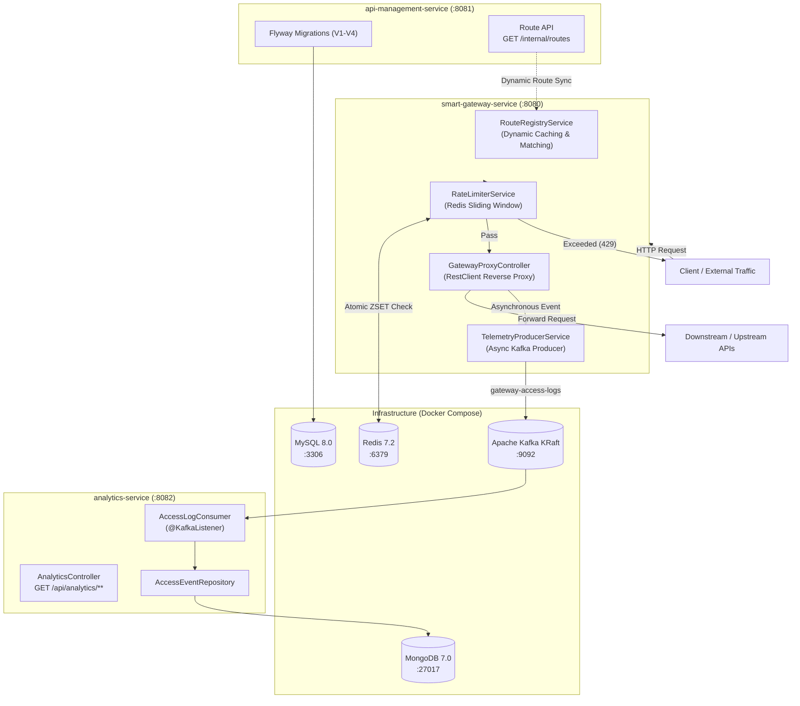

# Gatekeeper - Distributed API Gateway & Management Platform

A production-grade, microservices-based API Gateway and Management Platform built with **Spring Boot 4 / Java 21**, **Apache Kafka (KRaft)**, **Redis**, **MongoDB**, **MySQL**, and **Flyway**.

---

## 🏛 System Architecture



---

## 🚀 Key Modules & Implemented Features

1. **Dynamic Routing Engine (`smart-gateway-service`)**:
   - Dynamic route registration and path pattern matching (`AntPathMatcher`).
   - Periodic background sync from `api-management-service` (`/internal/routes`) with resilient fallback defaults.
   - High-performance HTTP request forwarding via Spring's `RestClient` (`JdkClientHttpRequestFactory`).
   - Hop-by-hop header stripping and route-specific connection/read timeout enforcement with `504 Gateway Timeout` mapping.

2. **Distributed Rate Limiting (`smart-gateway-service`)**:
   - Redis **Sliding Window Counter** using Sorted Sets (`ZSET`) keyed by `ratelimit:{routeId}:{clientIp}`.
   - Enforces configurable `requests_per_minute` per route across multiple horizontal gateway nodes.
   - Graceful fail-open strategy if Redis is temporarily unreachable.
   - Returns standard HTTP `429 Too Many Requests` with `Retry-After: 60` and `X-RateLimit-Limit` headers.

3. **Asynchronous Telemetry Pipeline (`smart-gateway-service` + `analytics-service`)**:
   - Non-blocking Kafka producer streaming access logs (`routeId`, `clientIp`, `httpMethod`, `requestUri`, `statusCode`, `latencyMs`, `timestamp`) on topic `gateway-access-logs`.
   - Consumer group `analytics-group` in `analytics-service` ingesting events into **MongoDB** (`access_events` collection).
   - Real-time analytics endpoints querying route performance, request volume, error rates, and average latency.

4. **Multi-Tenant Schema & Flyway Evolution (`api-management-service`)**:
   - Automated schema migrations (`V1` to `V4`) managing `organizations`, `management_users`, `api_routes`, and `route_allowed_methods`.
   - Control plane REST endpoints exposing route definitions to edge gateway nodes.

---

## 🛠 Prerequisites

- **Java 21+** (e.g. OpenJDK 21)
- **Maven 3.9+**
- **Docker & Docker Compose**

---

## 🏃 Getting Started

### 1. Launch All Infrastructure (Docker Compose)

Start MySQL, Redis, Kafka (KRaft), and MongoDB in one command:

```bash
docker compose up -d
```

Check container status:
```bash
docker compose ps
```

### 2. Start the Microservices

Open 3 terminal windows or run in background:

```bash
# Terminal 1: API Management Service (Port 8081)
cd api-management-service
mvn spring-boot:run

# Terminal 2: Smart Gateway Service (Port 8080)
cd smart-gateway-service
mvn spring-boot:run

# Terminal 3: Analytics Service (Port 8082)
cd analytics-service
mvn spring-boot:run
```

---

## 🧪 Verification & Testing

### 1. Test Edge Proxy Routing
Make a GET request through the gateway to access JSONPlaceholder via the configured `/api/users/**` route:
```bash
curl -i http://localhost:8080/api/users/1
```
*Expected: 200 OK with user details forwarded from upstream.*

### 2. Test Distributed Rate Limiting (429 Too Many Requests)
The route `/api/test-limit/**` is configured with a strict limit of **5 requests per minute**:
```bash
for i in {1..7}; do
  curl -i -s http://localhost:8080/api/test-limit/get | grep "HTTP"
done
```
*Expected: The first 5 requests return `200 OK`, followed by `HTTP/1.1 429 Too Many Requests` with rate limit headers.*

### 3. Test Real-Time Telemetry & Analytics
Check the telemetry events and metrics recorded in MongoDB by querying `analytics-service`:
```bash
# View aggregated statistics for a specific route
curl -s http://localhost:8082/api/analytics/routes/route-users | jq .

# View recent access log entries
curl -s http://localhost:8082/api/analytics/events | jq .
```
